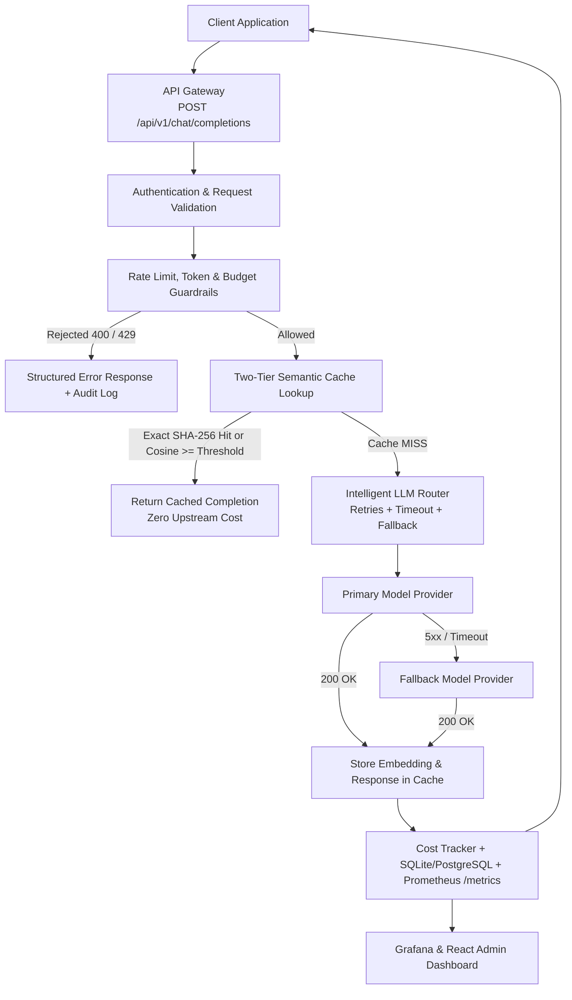

# Cost & Latency Guardrail Proxy

**AI Infrastructure Optimization Platform**

An intelligent middleware gateway sitting between client applications and external Large Language Model (LLM) providers. It reduces LLM API expenditure, accelerates repeat and semantically equivalent queries, enforces rate/budget guardrails, routes around upstream failures, and exposes real-time telemetry to Prometheus, Grafana, and an administrative React console.

---

## Problem Statement

Production LLM workloads frequently incur unnecessary cost and tail latency from:
- **Redundant or paraphrased prompts** hitting expensive frontier models repeatedly.
- **Unbounded token and spend growth** without per-client rate limits or daily/monthly budget ceilings.
- **Upstream transient failures or latency spikes** causing cascading application outages when no automated fallback routing exists.
- **Lack of centralized observability** into per-model expenditure, cache hit ratios, and P95 latency.

## Project Objectives

1. Route OpenAI-compatible `POST /api/v1/chat/completions` requests through a hardened gateway.
2. Eliminate redundant upstream calls using two-tier **SHA-256 exact-match** and **cosine-similarity semantic caching**, isolated strictly by model, system prompt, temperature bucket, and client scope.
3. Track token consumption, estimated expenditure, and avoided cache cost using configurable per-model token rates.
4. Enforce real-time RPM rate limits, maximum token windows, and daily/monthly spend guardrails.
5. Automatically retry transient upstream errors and switch to configured fallback models when permitted.
6. Provide Prometheus `/metrics`, Grafana dashboards, and a live React + Recharts admin interface.

---

## System Architecture



---

## Technology Stack

- **Gateway & Runtime**:
  - **Containerized Production Stack**: Python 3.11, FastAPI, Pydantic, Uvicorn, HTTPX, Redis, Sentence Transformers (`all-MiniLM-L6-v2`), SQLAlchemy (SQLite / PostgreSQL), Prometheus Client, Grafana.
  - **Integrated Full-Stack Preview**: Express, TypeScript, Node 22 native SQLite WAL, `@google/genai`, OpenAI-compatible HTTP client.
- **Frontend Dashboard**: React 19, Vite, Tailwind CSS v4, Recharts, Lucide Icons.
- **Infrastructure & Testing**: Docker, Docker Compose, Nginx, Pytest + HTTPX TestClient, Node integration test runner.

---

## Request Lifecycle

1. **Authentication & Validation**: Extracts `X-API-Key` or `Authorization: Bearer` token, validates against SHA-256 hashed client keys or environment keys, and validates `messages`, `model`, and `temperature`.
2. **Guardrails**: Checks estimated input tokens and requested `max_tokens` against policy limits, evaluates sliding-window per-client RPM limits (`429 Retry-After`), and verifies current daily/monthly expenditure against budget ceilings.
3. **Two-Tier Semantic Cache**:
   - Computes a `settings_hash` isolating `model`, `system` prompts, `temperature` bucket, `max_tokens`, and `client_id`.
   - **Tier 1 (Exact)**: SHA-256 hash lookup (`HIT_EXACT`).
   - **Tier 2 (Semantic)**: Generates dense vector embedding and computes cosine similarity against active entries sharing the same `settings_hash` (`HIT_SEMANTIC` if `score >= similarity_threshold`).
4. **Intelligent Router**: On cache miss, executes primary model with `AbortController`/HTTPX timeout and retry backoff. If primary fails after retries and fallback is enabled, routes to fallback model (`X-Fallback-Used: true`).
5. **Persistence & Telemetry**: Records request ID, tokens, estimated cost/savings, total latency, local lookup duration, and cache status in SQLite/PostgreSQL and Prometheus metrics.

---

## Environment Variables

Copy `.env.example` to `.env` and configure values as needed. Never commit `.env` or API secrets.

| Variable | Purpose | Default |
|---|---|---|
| `MOCK_PROVIDER_MODE` | Use local mock LLM responses when external keys are absent | `true` |
| `OPENAI_API_KEY` | Upstream OpenAI-compatible API key (server-side only) | `""` |
| `OPENAI_BASE_URL` | OpenAI-compatible base URL | `https://api.openai.com/v1` |
| `GEMINI_API_KEY` | Optional Gemini API key (server-side only) | `""` |
| `PRIMARY_MODEL` | Default primary model | `gpt-4o` |
| `FALLBACK_MODEL` | Fallback model on primary failure | `gpt-4o-mini` |
| `ADMIN_PASSCODE` | Admin credential (leave blank for first-run UI claim) | `""` |
| `PROXY_CLIENT_API_KEY` | Shared client gateway key | `""` |
| `SEMANTIC_SIMILARITY_THRESHOLD` | Cosine similarity cutoff (`0.50`–`0.99`) | `0.84` |
| `CACHE_TTL_SECONDS` | Cache entry expiration in seconds | `3600` |
| `REDIS_URL` | Redis connection URL (FastAPI stack) | `redis://localhost:6379/0` |
| `DATABASE_URL` | SQLAlchemy URL (SQLite or PostgreSQL) | `sqlite:///./proxy_metrics.db` |

---

## Installation & Running Locally

### Option A: Integrated Full-Stack Server (Node + Vite + SQLite)
```bash
npm install
npm run dev
# Opens gateway + React admin dashboard on http://localhost:3000
```

### Option B: Docker Compose (FastAPI + Redis + PostgreSQL + Frontend + Prometheus + Grafana)
```bash
docker compose up --build
```
- **Admin Dashboard**: `http://localhost:3000`
- **FastAPI Gateway**: `http://localhost:8000`
- **Prometheus**: `http://localhost:9090`
- **Grafana**: `http://localhost:3001`

---

## API Reference

| Method | Endpoint | Auth | Description |
|---|---|---|---|
| `POST` | `/api/v1/chat/completions` | Client Key / Session | OpenAI-compatible gateway with semantic cache & routing |
| `GET` | `/api/v1/health` | Public | Liveness & database/cache health check |
| `GET` | `/api/v1/system/status` | Public | Detailed subsystem status |
| `GET` | `/api/v1/analytics/overview` | Public | Totals, cache hit ratio, latency P50/P95, cost & savings |
| `GET` | `/api/v1/analytics/requests` | Public | Filterable request audit log |
| `GET` | `/api/v1/analytics/costs` | Public | Daily/monthly spend & model-wise cost breakdown |
| `GET` | `/api/v1/analytics/tokens` | Public | Token consumption by model |
| `GET` | `/api/v1/cache/stats` | Public | Cache hit/miss stats & active cached prompts |
| `DELETE` | `/api/v1/cache/clear` | Admin | Clear cached prompt entries |
| `GET` | `/api/v1/guardrails/status` | Public | Current limits & utilization percentages |
| `POST` | `/api/v1/guardrails/config` | Admin | Update budgets, RPM, max tokens, threshold, TTL, retries |
| `GET` | `/api/v1/providers` | Public | Configured models & pricing rates |
| `GET` | `/metrics` | Public | Prometheus metrics exposition (`text/plain; version=0.0.4`) |

---

## Automated Testing

### Node Gateway Integration Suite
```bash
node --test server/tests/proxy.test.ts
```

### Python FastAPI + Pytest Suite
```bash
cd backend
pip install -r requirements.txt
pytest -v
```

---

## Performance Benchmarking Methodology

Run the benchmarking script against a live gateway instance:
```bash
python3 benchmark/run_benchmark.py --base-url http://localhost:3000 --api-key <CLIENT_OR_ADMIN_TOKEN>
```

The benchmark reports:
- **Local Cache Lookup Time (`X-Cache-Lookup-Ms`)** vs **Total Client-Observed Latency (`ms`)**.
- **P50 & P95 Latency** across uncached, exact-match cached, and semantic-cached workloads.
- **External Provider Call Reduction** and **Estimated Cost Savings** computed strictly from configured model pricing (distinct from actual provider invoice billing).

---

## Future Improvements

- Redis Stack RediSearch HNSW vector index integration for multi-million-entry sub-millisecond ANN lookups.
- Streaming SSE (`stream: true`) response caching and token-by-token guardrail termination.
- OpenTelemetry distributed trace export alongside Prometheus metrics.
